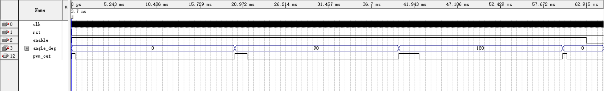
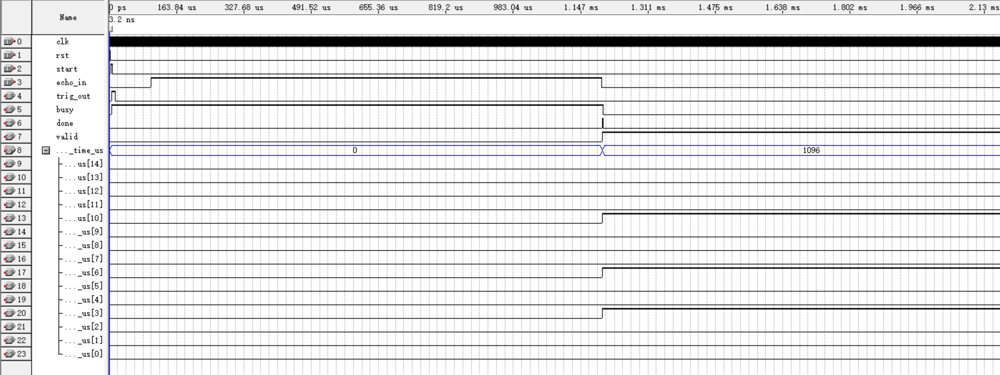
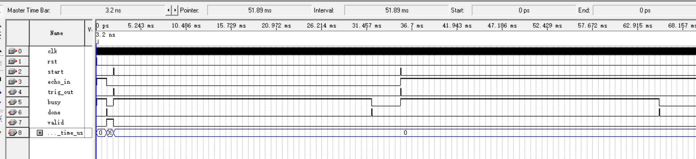
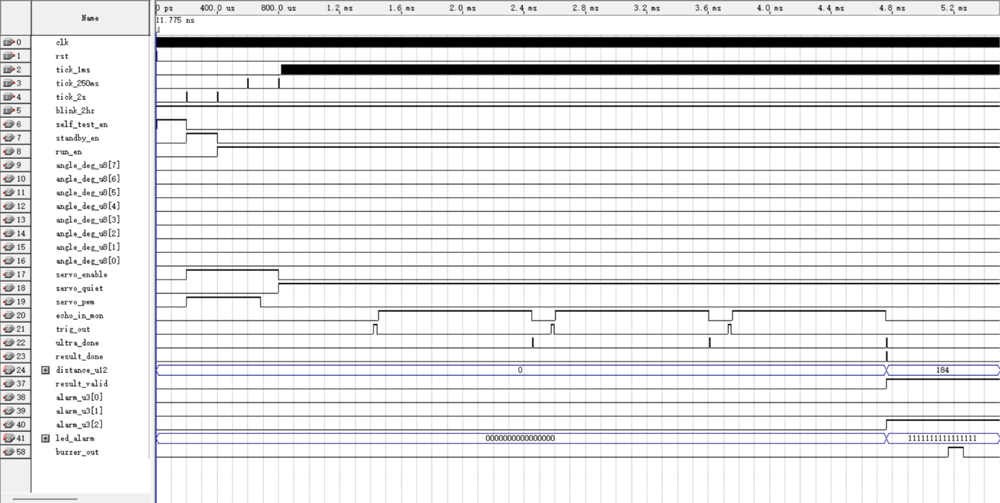
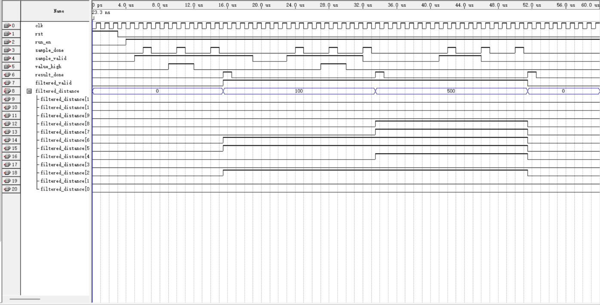
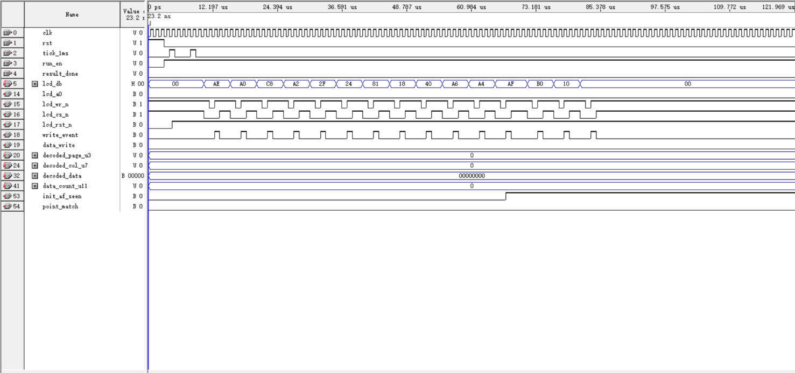
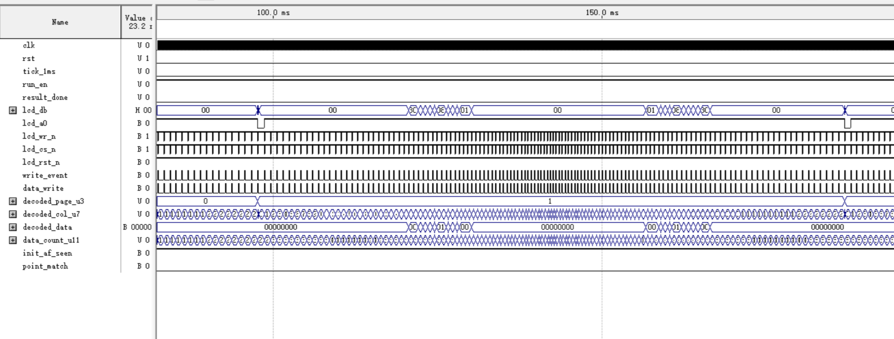

# 雷达自动检测报警系统（VHDL）

本项目基于 EPM1270T144C5 数字实验板，使用 VHDL 和 Quartus II 9.1 实现舵机扫描、超声波测距、距离滤波、数码管显示、点阵雷达图以及声光报警。仓库主工程为 [`fusion/radar_fusion.qpf`](fusion/radar_fusion.qpf)，它把基础功能和提高功能合并在同一份可烧录工程中，并通过SW6选择运行模式。

## 主工程

演示和继续开发默认打开 `fusion/radar_fusion.qpf`，顶层实体为 `radar_fusion_top`：

- SW7：整机开关；
- SW6=0：基础模式，运行五角度扫描、数码管、点阵、LED和蜂鸣器，LCD清屏；
- SW6=1：提高模式，运行5°小步进扫描、数码管、距离等级LED和半圆LCD雷达图。

主工程已经通过Quartus II 9.1完整编译并生成POF，使用1256/1270个逻辑单元。原基础版、独立提高版和跟踪版继续保留，用于单独烧录、对照验证和分模块仿真。

## 当前进度

基础功能和提高功能现已合并到 `radar_fusion_top` 主顶层，并通过Quartus完整编译。基础模式采用“舵机PWM运行500 ms、关闭后等待300 ms、连续测量3次、保持关闭直到下一角度”的时序；提高模式每5°移动一次，输出80 ms PWM、静默50 ms后连续测量3次。超声波探头已经固定在舵机支架上，并在完整装机状态下进行了长时间、多角度往返扫描。仅使用板载5 V供电时，舵机扫描和超声波测距保持稳定，未再出现持续丢失回波或舵机异常回转。超声波采用固定增加13 mm的零点补偿，246～1200 mm实测范围内复测结果准确。五档LED与蜂鸣器报警已经通过实物验证，LCD雷达图案、显示方向和当前对比度均正常。

独立基础版已经完成舵机、超声波、数码管、点阵、LCD及声光报警的整机联合验证。独立提高版也已完成长时间、多角度扫描测试，运行表现稳定；这些经过实物验证的校准值和静默测量方法已经用于融合主工程。

## 工程版本

最终双模式融合版是仓库主工程，其余版本作为专项工程保留：

- `fusion/radar_fusion.qpf`：[基础/提高双模式融合版](fusion/README.md)，在同一份POF中保留基础功能和提高功能，通过SW6实时选择模式，是当前默认编译和演示工程。
- 根目录`radar.qpf`：基础功能版，包含五角度扫描、数码管、点阵、LED、蜂鸣器和LCD静态雷达图。
- `enhanced/radar_enhanced.qpf`：提高功能版，使用5°小步进近似匀速往返扫描，保留超声波三次测量、数码管和 LCD 雷达图，关闭点阵及声光报警。
- `tracking/radar_tracking.qpf`：[100 mm 目标跟踪版](tracking/README.md)，保留数码管与简化 LCD 状态显示，加入候选复测、左右跟随和丢失恢复。

提高版每 650 ms 前进 5°。每个角度先输出 80 ms 舵机 PWM，关闭 PWM 并静默 50 ms，随后完成三次超声波测量；完整编译使用 1238/1270 个逻辑单元。跟踪版复用校准后的舵机脉宽和距离换算，完整编译使用 1111/1270 个逻辑单元。跟踪版尚需在 100 mm 附近上板校准和验证。

## 最终双模式融合版

融合版顶层为 `radar_fusion_top`，目标器件仍为 `EPM1270T144C5`。SW7控制整机开关，SW6选择功能：SW6=0运行基础模式，SW6=1运行提高模式。SW6输入经过两级同步和约20 ms消抖，模式切换后会清除旧角度、旧距离和显示状态，再重新执行自检，防止上一模式的数据进入新模式。

两种模式共用一套舵机PWM、37项人工校准脉宽表、超声波测距、三次测量滤波、距离换算和数码管显示。基础模式采用45°步进，保留五方向点阵、LED和蜂鸣器，LCD保持清屏；提高模式采用5°步进近似匀速扫描，保留数码管和半圆LCD雷达图，点阵与蜂鸣器关闭。提高模式继续使用LED显示当前距离等级，换角后在新测量产生前暂时熄灭。

为适配MAX II有限资源，融合版只保存基础模式五个方向的距离等级，不重复保存全部毫米值；距离数码管使用逐位减法转换；提高模式LCD保留半圆外轮廓、底边和每5°方向的障碍点，并将障碍距离按100 mm划分为8档。实际毫米距离仍由数码管显示。

融合版已通过Quartus II 9.1完整编译，生成可烧录POF，Fitter使用1256/1270个逻辑单元和75/116个引脚，1 MHz时钟约束通过。`fusion/sim/`中的VWF已经验证两种模式的扫描、舵机驱动与静默、三次测距、BCD转换和LCD写入。该工程资源余量为14个逻辑单元，后续不宜继续增加较大功能。

`fusion_tracking/`保存的是三模式共存试验。它的综合逻辑达到1386/1270，超过器件容量，因此没有可用POF，也不作为最终烧录工程。跟踪功能继续使用独立的 `tracking/radar_tracking.qpf`。

## 基础模式工作流程

SW7 打开后，系统先进行 2 秒自检，再进入 2 秒待机，随后开始扫描。扫描角度按照下面的顺序循环：

```text
0° -> 45° -> 90° -> 135° -> 180° -> 135° -> 90° -> 45°
```

每个角度保持约 2 秒。舵机先接收 500 ms PWM，到达目标位置后关闭 PWM，再等待 300 ms，使电源和地线扰动减小。随后超声波连续测量 3 次，相邻两次间隔 60 ms。

三次结果全部有效时取中值，两次有效时取平均值；少于两次有效时，本轮结果判为无效。角度切换后，旧距离不会继续驱动当前角度的数码管、LED和蜂鸣器，只有当前角度的新测量完成后才恢复显示和报警。

## 距离分级

| 距离范围 | 点阵颜色 | LED与蜂鸣器状态 |
|---|---|---|
| `distance >= 800 mm` | 绿色 | 4个低位LED常亮，不发声 |
| `600 mm <= distance < 800 mm` | 黄绿色 | 4个LED以2 Hz闪烁，低频鸣叫 |
| `400 mm <= distance < 600 mm` | 黄色 | 4个LED以2 Hz闪烁，中低频鸣叫 |
| `200 mm <= distance < 400 mm` | 橙色 | 4个LED以2 Hz闪烁，中高频鸣叫 |
| `distance < 200 mm` | 红色 | 16个LED以2 Hz闪烁，高频鸣叫 |

无有效测量结果时，距离显示为横线，当前角度不触发报警。

## 主要模块

```text
rtl/
  radar_top.vhd          顶层连接与当前角度结果门控
  timebase.vhd           1 ms、250 ms、2 s节拍和2 Hz闪烁信号
  system_ctrl.vhd        关闭、自检、待机和运行状态控制
  scan_ctrl.vhd          五个方向的往返扫描序列
  servo_pwm.vhd          SG90舵机20 ms周期PWM
  measure_ctrl.vhd       舵机稳定、静默和三次测量调度
  ultrasonic.vhd         HC-SR04触发、ECHO计时及超时保护
  distance_calc.vhd      回波时间到毫米距离的换算
  distance_median3.vhd   三次测量筛选与中值处理
  distance_bcd.vhd       距离的BCD分解
  direction_store.vhd    五个方向的距离和有效标志存储
  seg_display_ctrl.vhd   八位数码管动态显示
  seg_decoder.vhd        七段数码管译码
  dot_matrix_ctrl.vhd    8×8双色点阵雷达图
  lcd_bus_writer.vhd     LCM12864单字节并行写时序
  lcd12864_ctrl.vhd      LCD复位、初始化和显存刷新控制
  lcd_radar_renderer.vhd 128×64扇形雷达图与五方向目标标记
  alarm_led_ctrl.vhd     距离分级和LED控制
  buzzer_ctrl.vhd        分级蜂鸣器节奏

tb/
  servo_pwm.vwf          舵机PWM模块仿真
  ultrasonic.vwf         超声波模块仿真
  measure_ctrl.vwf       静默期和三次测量调度仿真

simulation/
  README.md              新增分层仿真的结果与查看方法
  median3/               三点中值及无效样本处理
  basic_flow/            基础版主流程联合仿真
  enhanced_scan/         提高版5°往返扫描
  lcd_writer/            LCD单字节总线时序
  lcd_renderer/          基础版关键坐标像素生成
  enhanced_lcd/          提高版整帧与目标点写入

fusion/
  radar_fusion.qpf       最终基础/提高双模式融合工程
  README.md              融合方式、资源优化和验证记录
  sim/                   融合版扫描、测量、BCD和LCD仿真

rtl/fusion/
  radar_fusion_top.vhd   融合版顶层及模式切换
  fusion_scan_ctrl.vhd   基础/提高共用扫描控制
  fusion_measure_ctrl.vhd 共用静默与三次测量调度
  fusion_lcd_radar_ctrl.vhd 资源优化后的融合版LCD控制

docs/
  hardware_test_log.md   实物测试现象与整改记录
  images/                仿真截图

radar.qpf                保留的独立基础版Quartus工程
radar.qsf                独立基础版的器件、引脚、时钟和源文件设置
```

## 仿真方法

本项目使用 Quartus II 9.1 自带的 VWF 波形文件进行仿真，不以 VHDL testbench 作为操作流程。

仿真采用分层方式：先分别验证各功能模块，再用顶层 VWF 检查系统状态、舵机静默、超声波启动和结果更新是否按顺序触发。顶层仿真只检查主流程，不同时展开所有内部数据，以免波形过于复杂。

### SG90 PWM仿真

`servo_pwm.vwf` 验证了 20 ms PWM周期，以及0°、90°和180°对应的高电平宽度。



### HC-SR04仿真

`ultrasonic.vwf` 验证了20 μs TRIG、正常回波计时、30 ms无回波超时和ECHO卡高保护。`done`为一个主时钟周期的完成脉冲。





### 新增分层仿真

三点滤波、基础版主流程、提高版5°扫描、LCD总线、基础版像素生成和提高版真实LCD控制器均已使用独立VWF工程完成仿真。基础版主流程验证了状态启动、舵机静默、三次测距、距离滤波和声光报警的完整触发关系；提高版LCD仿真验证了初始化与跨页连续写入过程。下面只采用在Quartus II 9.1中实际运行并人工筛选的波形截图，不使用脚本绘制的示意波形。

各 VWF 的路径、压缩节拍说明和预期数值见 [VWF分层仿真说明](simulation/README.md)。









## 工程状态

- 主工程：`fusion/radar_fusion.qpf`
- 顶层实体：`radar_fusion_top`
- 目标器件：`EPM1270T144C5`
- 主时钟：1 MHz
- 时钟约束：1 MHz
- 未使用引脚：三态输入
- Fitter逻辑资源占用：1256/1270（99%）
- 引脚占用：75/116（65%）
- 最高时钟频率报告：38.12 MHz
- 融合主工程已完成超声波随舵机安装状态下的长时间、多角度上板验证；跟踪版LCD与跟踪行为仍待上板验证

完整实物现象和后续校准项目见 [硬件测试记录](docs/hardware_test_log.md)。

## 开发约定

- 所有时序模块使用同一个1 MHz主时钟，以单周期 `tick` 作为时钟使能；
- 每个模块先独立检查，再接入顶层；
- 仿真只使用 `.vwf` 文件；
- `db/`、编译报告、下载文件和其他可再生文件不提交到仓库。
