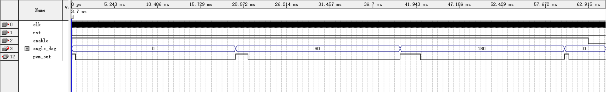
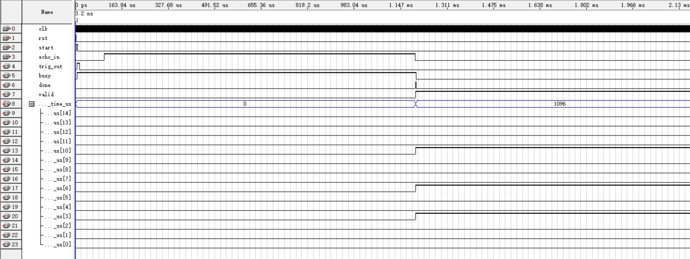
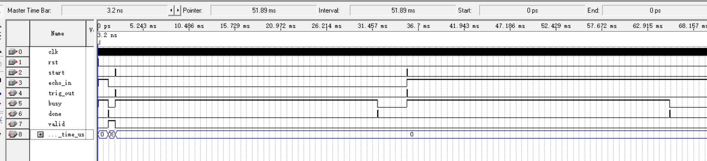
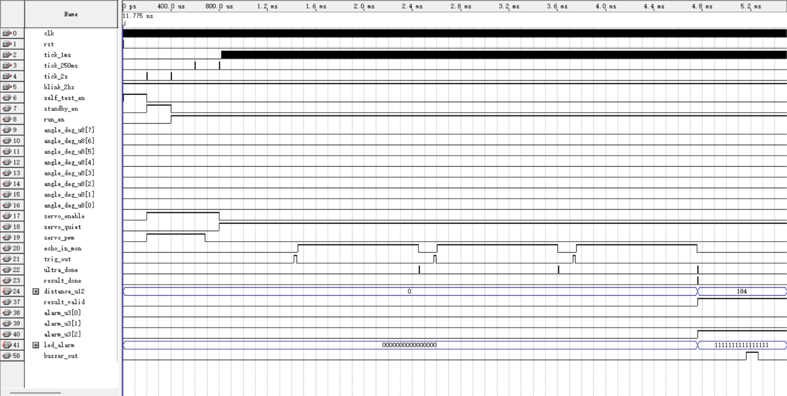
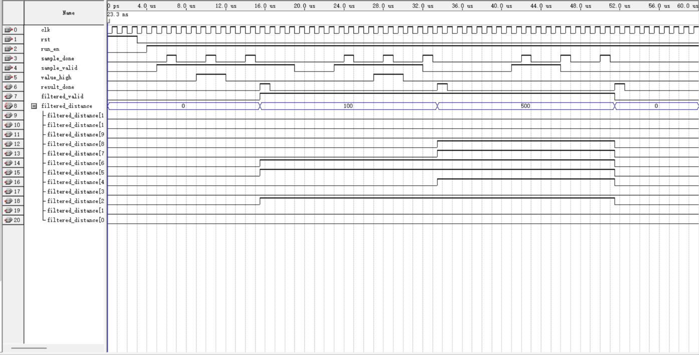
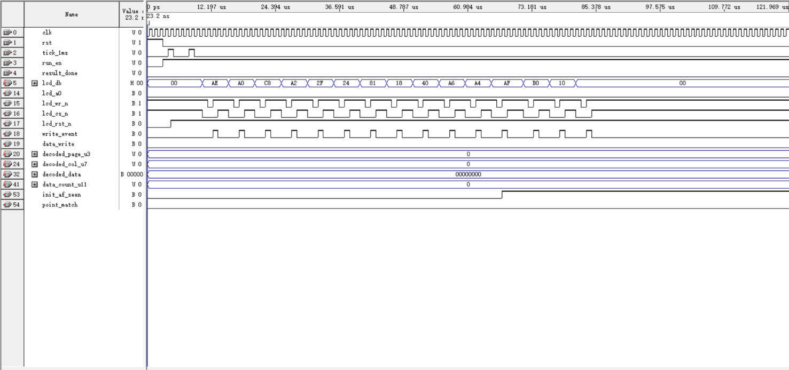
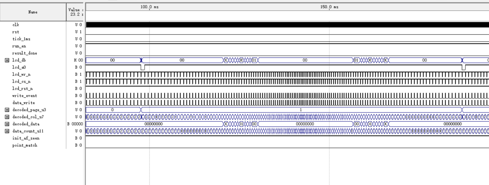

# 仿真与验证记录

本目录集中说明项目已经完成的 Quartus VWF 仿真、结果波形和实验报告截图。原始 `.vwf`、独立仿真工程和截图都保留在原位置，没有移动、改名或重新压缩。

项目仿真统一使用 Quartus II 9.1 自带的 VWF 波形编辑器，不以 VHDL testbench 作为主要操作流程。验证采用分层方式：先检查单个模块，再检查多个模块之间的触发顺序。联合仿真只展开当前需要观察的信号，避免在一个波形文件里同时加入全部内部变量。

## 原始模块仿真

### SG90 舵机 PWM

`../../tb/servo_pwm.vwf`验证20 ms PWM周期，以及0°、90°和180°对应的高电平宽度。

### HC-SR04 超声波

`../../tb/ultrasonic.vwf`验证20 µs TRIG、正常ECHO计时、30 ms无回波超时和ECHO卡高保护。`done`只保持一个主时钟周期。

### 测量调度

`../../tb/measure_ctrl.vwf`用于观察舵机稳定、静默等待、超声波启动、完成返回和下一次测量之间的先后关系。

## 基础版分层仿真

`../../simulation/`保存了基础模块和提高模块的独立VWF工程。长时间节拍在联合仿真中进行了压缩：`tick_1ms`仍表示一次1 ms使能事件，但波形中不必真的等待1 ms。这样检查的是状态转换次数、信号先后顺序和数据传递；舵机PWM、TRIG和ECHO仍按照1 MHz时钟以真实微秒计数。

| 工程 | VWF | 验证结果 |
|---|---|---|
| `median3/median3_sim.qpf` | `median3.vwf` | 三个有效值取中值；两个有效值取平均；少于两个有效值输出无效 |
| `basic_flow/basic_flow_sim.qpf` | `basic_flow.vwf` | 自检、待机、运行、舵机静默、三次测距、滤波和声光报警的完整触发关系 |
| `enhanced_scan/enhanced_scan_sim.qpf` | `enhanced_scan.vwf` | 5°步进从0°到180°再返回，角度、序号和37项校准脉宽同步变化 |
| `lcd_writer/lcd_writer_sim.qpf` | `lcd_writer.vwf` | A0、CS、WR、busy和done的LCD单字节写时序 |
| `lcd_renderer/lcd_renderer_sim.qpf` | `lcd_renderer.vwf` | 自检填充、方向线和不同方向障碍标记的像素字节 |
| `enhanced_lcd/enhanced_lcd_sim.qpf` | `enhanced_lcd.vwf` | LCD初始化、1024字节背景帧和90°/400 mm障碍点写入 |

基础版主流程实际得到184 mm结果、报警等级4，并触发16位LED与蜂鸣器响应。

三次测距滤波截图包含三个有效样本取中值、两个有效样本取平均、少于两个有效样本时输出无效三种情况。

提高版LCD仿真分别保留初始化过程和跨页连续写入过程。初始化图包含12条初始化指令和`AFh`完成标志；跨页图展示第0页写完后切换到第1页、列地址回到0以及数据计数连续增加。

`enhanced_lcd`仿真工程曾使用EPM2210F324C3容纳额外的观察逻辑，被测对象仍是正式的`enhanced_lcd_radar_ctrl.vhd`。正式烧录工程始终使用EPM1270T144C5。

## 双模式融合版仿真

`../../fusion/sim/`保留双模式融合工程的4组VWF：

| 工程 | 检查内容 |
|---|---|
| `fusion_scan.qpf` | 基础45°扫描、提高5°扫描、往返方向及校准脉宽 |
| `fusion_measure.qpf` | 两种模式下的舵机驱动、静默和三次超声波触发 |
| `fusion_bcd.qpf` | 50～4000 mm边界值、无效值、百位/千位及完成脉冲 |
| `fusion_lcd.qpf` | 初始化、1024字节背景，以及90°/400 mm障碍点写入 |

`*_basic_result.vwf`和`*_enhanced_result.vwf`是Quartus运行后保存的对应模式结果。这里的`.qpf`都是独立仿真工程，不是烧录工程。

## 独立跟踪版仿真

`../../tracking/sim/`保留目标跟踪的输入波形、Quartus结果波形和检查脚本：

| 工程 | 输入波形 | 检查内容 |
|---|---|---|
| `target_tracker_sim` | `target_tracker_lock.vwf`、`target_tracker_edge.vwf` | 首次发现、复测、100/120 mm边界、无效结果、左右跟随、丢失恢复和角度边界 |
| `tracking_flow_sim` | `tracking_flow.vwf` | 舵机驱动、50 ms静默、三次测距、中值结果及下一次换角的顺序 |
| `tracking_servo_sim` | `tracking_servo.vwf` | 五个校准锚点的20 ms PWM高电平宽度 |

输入波形由`make_vectors.py`生成，实际结果以`*_result.vwf`保存，`check_results.py`读取Quartus结果检查关键时刻。控制波形中的`tick_1ms`经过加速，因此应按节拍数理解；舵机PWM波形使用真实1 MHz时钟。

## 最终三模式版本的验证关系

最终工程`../../fusion_tracking/radar_fusion_tracking.qpf`沿用了以上已经分层验证和上板校准的舵机脉宽表、超声波协议、距离换算、静默测量、三次滤波、基础显示报警和跟踪控制。最终版又完成了Quartus完整编译、时序检查和实际烧录，用户确认三种模式融合运行正常。

按照项目最后的决定，最终三模式顶层没有另外制作一份大而复杂的VWF。其验证证据由上述模块/历史工程VWF、最终完整编译报告和上板结果共同组成。

## 在 Quartus II 9.1 中重新查看

1. 打开对应目录的`.qpf`。
2. 双击同目录的`.vwf`，已有文件包含输入和保存的仿真输出。
3. 总线可在Waveform Editor中改成`Unsigned Decimal`或`Hexadecimal`。
4. 需要重新运行时，先执行 **Processing → Generate Functional Simulation Netlist**，再在波形编辑器中执行功能仿真。

更详细的独立仿真节拍和观察信号说明仍保留在[`../../simulation/README.md`](../../simulation/README.md)，实物测试与校准见[`../hardware_test_log.md`](../hardware_test_log.md)。
